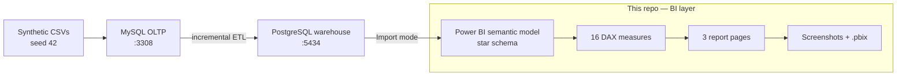

# BeanStream — Power BI KPI Dashboard

A three-page **Power BI** report over the **BeanStream** star-schema warehouse from
[`ecommerce-data-platform-practice-project`](https://github.com/malikb0/ecommerce-data-platform-practice-project).
The platform owns ingestion, modelling, and SQL; this repo owns the **BI layer**: Power Query, a
star-schema semantic model, 16 DAX measures, and a report that reconciles to the source KPI summary.


> Independent, original work. The warehouse and synthetic data come from the author's platform repo;
> nothing here is real customer data. Power BI, PostgreSQL, Docker, and MySQL are trademarks of their
> respective owners. See [`NOTICE.md`](NOTICE.md).

## 🏗️ Architecture



The report reads the warehouse in **Import** mode. `dim_date` is the marked date table; `MonthStart`
drives monthly axes and time intelligence. Cancelled orders stay in `fact_sales` and are excluded in
measures, not in Power Query. The full design rationale — Import mode, single-direction relationships,
the date table, and the 2024-only limitation — is in [`docs/architecture.md`](docs/architecture.md).

## 🚀 Quickstart

**Requirements:** Power BI Desktop (Windows) to open the report; Docker Desktop and the platform repo
only to refresh or rebuild the warehouse.

```bash
# 1. Prepare the platform data (in the platform repo)
make setup
make up
make seed
make etl
```

2. Open [`powerbi/beanstream-kpi.pbix`](powerbi/beanstream-kpi.pbix) in **Power BI Desktop**.
3. **Home → Refresh**; if prompted, connect to `localhost:5434` / `warehouse` / `learner` / `learner`
   (Import mode).

The `.pbix` opens as a ready report; rebuild the model only if you want to follow the
[build guide](docs/spec.md).

## 📊 The dashboard

| Executive | Trends | Products & Customers |
|---|---|---|
| <a href="screenshots/01-executive.png"></a> | <a href="screenshots/02-trends.png"></a> | <a href="screenshots/03-products.png"></a> |

Executive answers *how much and where*; Trends answers *how it is moving*; Products & Customers answers
*what drives revenue*. Click any page for the full-size PNG.

## 🔍 Key findings

- **$7,261.50** revenue from **99** non-cancelled orders; **$73.35** AOV; **448** units.
- **October** is the peak month ($1,273.00); **March** the lowest ($252.75), with a sharp November drop
  ($286.00).
- **Coffee** is the largest category; the **app** channel contributes **49.03%** of revenue.
- **17.5%** of orders are cancelled — excluded from revenue, but visible as a quality KPI.
- **Latest month MoM** is **+190.03%** (December vs November).

## ✅ Status

Complete and verified (2026-10-20). The report refreshes against the synthetic warehouse and reconciles
to the platform's KPI summary; all three pages are screenshot-verified. The build is documented end to
end in the [build guide](docs/spec.md).

## 🧱 Data model

`fact_sales` (one row per order line) joins to `dim_date`, `dim_customer`, `dim_product`, and
`dim_channel` on integer keys. `dim_date` is the marked date table; `MonthStart` drives monthly axes.
Cancelled orders stay in the fact table and are excluded in measures, so cancellation remains
analysable. Star schema, grain, keys, and rules: [`docs/data-model.md`](docs/data-model.md); column
dictionary: [`data/README.md`](data/README.md).

## ✅ Validation

| KPI | Expected | Dashboard | Status |
|---|---:|---:|:---:|
| Total Revenue (non-cancelled) | 7,261.50 | 7,261.50 | ✅ |
| Orders (non-cancelled) | 99 | 99 | ✅ |
| Units Sold | 448 | 448 | ✅ |
| AOV | 73.35 | 73.35 | ✅ |
| Active Customers | 39 | 39 | ✅ |
| Customers (`dim_customer`) | 40 | 40 | ✅ |
| Products (`dim_product`) | 12 | 12 | ✅ |
| Cancelled Order % | 17.5% | 17.5% | ✅ |
| Latest Month MoM % | Dec vs Nov | +190.03% | ✅ |

`Customers` and `Products` are dimension row counts; the other KPIs are report cards. Source:
[`kpi_summary.md`](https://github.com/malikb0/ecommerce-data-platform-practice-project/blob/main/reports/expected/kpi_summary.md).

## 📦 What's inside

| Area | Where | Highlights |
|---|---|---|
| Report | `powerbi/beanstream-kpi.pbix` | 3 pages · 16 measures · theme |
| Measures | [`dax/measures.dax`](dax/measures.dax) | Core · Time · Quality · Share |
| Theme | [`theme/beanstream-theme.json`](theme/beanstream-theme.json) | Brown/cream palette |
| Build guide | [`docs/spec.md`](docs/spec.md) | Setup → pages → validation → publish |
| Architecture | [`docs/architecture.md`](docs/architecture.md) | Data flow, decisions, refresh, limits |
| Data model | [`docs/data-model.md`](docs/data-model.md) | Star schema, grain, keys, date table |
| Measure catalogue | [`docs/measures.md`](docs/measures.md) | Purpose, format, expected value |
| Data dictionary | [`data/README.md`](data/README.md) | Tables, columns, grain, rules |
| Case study | [`case-study.md`](case-study.md) | Portfolio write-up |
| Screenshots | `screenshots/` | 3 page exports |

## 🗺️ Documentation map

| Document | What it covers |
|---|---|
| [`docs/README.md`](docs/README.md) | Documentation hub — start here |
| [`docs/spec.md`](docs/spec.md) | Step-by-step build guide |
| [`docs/architecture.md`](docs/architecture.md) | Components, data flow, design decisions |
| [`docs/data-model.md`](docs/data-model.md) | ERD, grain, relationships, date table |
| [`docs/measures.md`](docs/measures.md) | All 16 measures and time-intelligence patterns |
| [`data/README.md`](data/README.md) | Source schema, column dictionary, caveats |
| [`docs/publishing.md`](docs/publishing.md) | Publishing checklist |
| [`case-study.md`](case-study.md) | Portfolio write-up |
| [`NOTICE.md`](NOTICE.md) | Provenance and trademark notes |

## ⚖️ Licence & provenance

MIT — see [`LICENSE`](LICENSE). Synthetic data (seed 42) from the platform repo; provenance and
trademark notes in [`NOTICE.md`](NOTICE.md).
