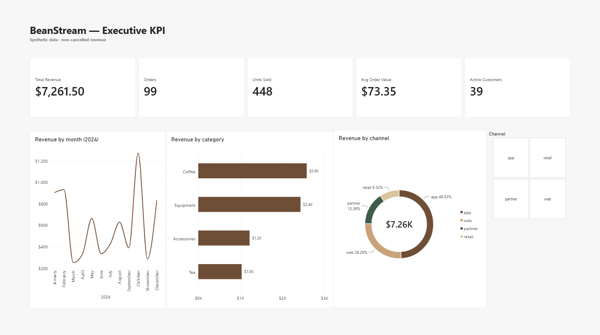
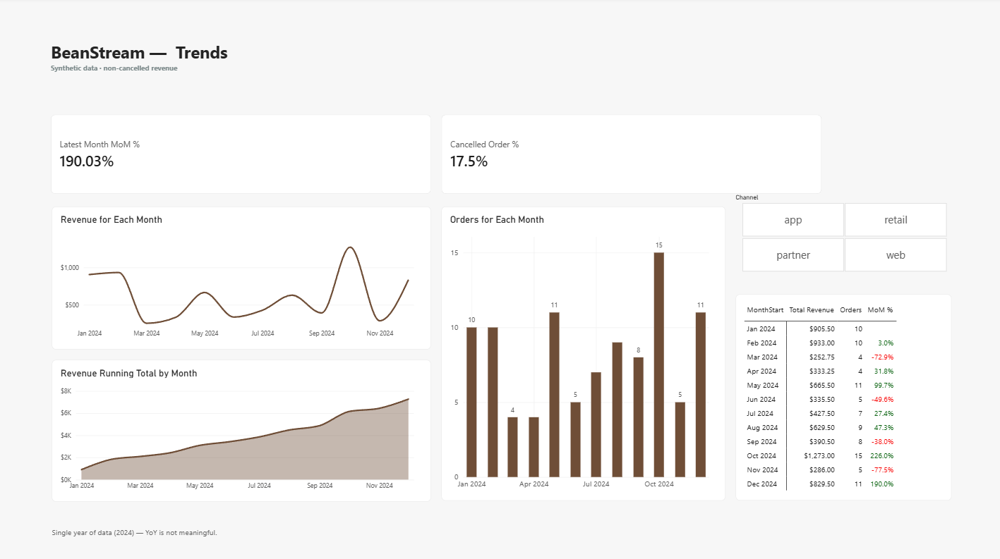
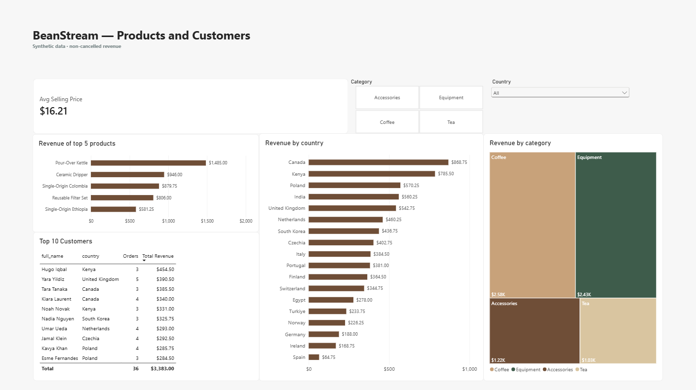

# BeanStream — Power BI KPI Dashboard

A three-page Power BI report over the **BeanStream** star-schema warehouse from
[`ecommerce-data-platform-practice-project`](https://github.com/malikb0/ecommerce-data-platform-practice-project).
The platform already proves the pipeline, model, and SQL; this repo proves **Power BI, Power Query, and
DAX**.

**Status:** Complete — built 2026-10-20. Synthetic data, 2024 only.
**Read:** [case study](case-study.md) · [build guide](docs/spec.md)

## Screenshots







## Pages

| Page | Answers |
|---|---|
| **Executive** | How much did we sell, and where? Five KPIs, revenue by month/category/channel |
| **Trends** | How is revenue moving month to month? Revenue, orders, MoM, cumulative revenue, cancellations |
| **Products & Customers** | Which products, categories, countries, and customers drive revenue? |

## Key findings

- **$7,261.50** revenue from **99** non-cancelled orders; **$73.35** AOV; **448** units.
- **October** is the peak month ($1,273.00); **March** the lowest ($252.75), with a sharp November drop
  ($286.00).
- **Coffee** is the largest category; the **app** channel contributes **49.03%** of revenue.
- **17.5%** of orders are cancelled — excluded from revenue, but visible as a quality KPI.

## Data

Reads the live PostgreSQL warehouse in **Import** mode:

| Setting | Value |
|---|---|
| Server | `localhost:5434` |
| Database | `warehouse` |
| User / password | `learner` / `learner` |

No raw data or database files are committed; the `.pbix` contains only the compact synthetic model.
Rebuild the warehouse in the platform repo:

```bash
make up
make seed
make etl
```

Schema, grain, and caveats: [`data/README.md`](data/README.md). The data covers **2024 only**, so
prior-year revenue is blank — `YoY %` is modelled but not shown.

## Model

`fact_sales` (one row per order line) → `dim_date`, `dim_customer`, `dim_product`, `dim_channel`.
Cancelled orders stay in the fact table and are excluded **in measures**, not in Power Query.
`MonthStart` is a calculated date column in `dim_date` used for month axes and `DATEADD`-based measures.

## Reconciliation

| KPI | Expected | Dashboard |
|---|---:|---:|
| Total Revenue (non-cancelled) | 7,261.50 | 7,261.50 |
| Orders (non-cancelled) | 99 | 99 |
| Units Sold | 448 | 448 |
| AOV | 73.35 | 73.35 |
| Active Customers | 39 | 39 |
| Customers (`dim_customer`) | 40 | 40 |
| Products (`dim_product`) | 12 | 12 |
| Cancelled Order % | 17.5% | 17.5% |

`Latest Month MoM %` (December vs November) is **+190.03%**. `Customers` and `Products` are dimension row
counts; the other rows are dashboard cards.

The complete step-by-step build is in [`docs/spec.md`](docs/spec.md); the 16 measures are in
[`dax/measures.dax`](dax/measures.dax); the report file is
[`powerbi/beanstream-kpi.pbix`](powerbi/beanstream-kpi.pbix).

## Repo map

| Path | Purpose |
|---|---|
| [`docs/spec.md`](docs/spec.md) | Step-by-step build guide |
| [`docs/publishing.md`](docs/publishing.md) | Publishing checklist |
| [`dax/measures.dax`](dax/measures.dax) | 16 measures |
| [`theme/beanstream-theme.json`](theme/beanstream-theme.json) | Report theme |
| [`case-study.md`](case-study.md) | One-page portfolio write-up |
| `powerbi/beanstream-kpi.pbix` | Report deliverable |
| `screenshots/` | Page exports |
| [`data/README.md`](data/README.md) | Source schema, grain, caveats |

## Licence

MIT — see [LICENSE](LICENSE). All data is synthetic, generated by the platform repo with seed 42.
