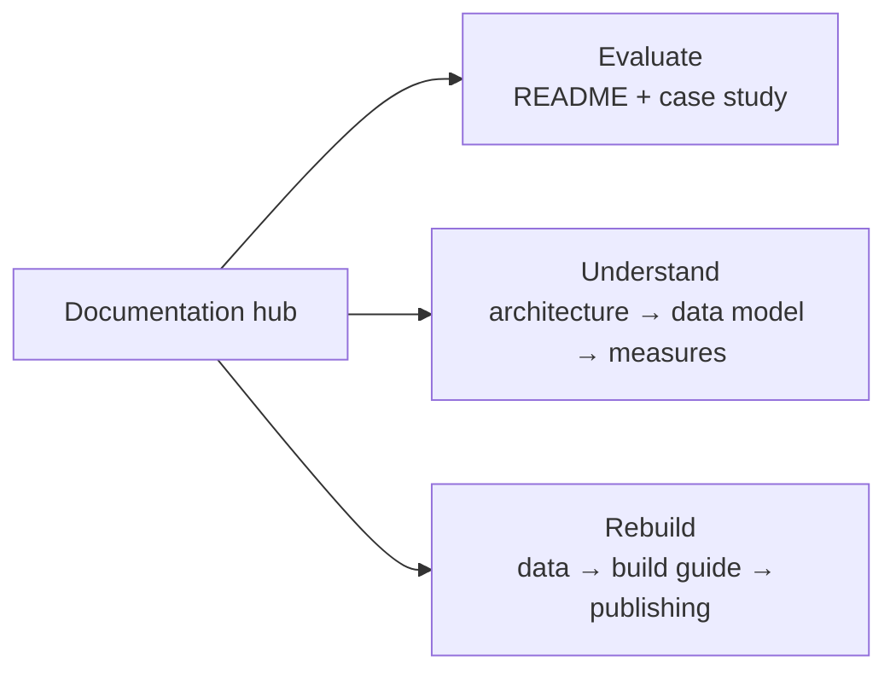

# Documentation

This repository is a working BI project, not a folder of notes. The documents below follow the same
path as the report: source data → semantic model → measures → pages → evidence → publication.

Start with the path that matches what you need. Each guide stands alone, but they cross-link so a
number, decision, or caveat can always be traced back to its source.

## Choose your path

| If you want to… | Start here | Then |
|---|---|---|
| **Evaluate the work** | [Project README](../README.md) | [Case study](../case-study.md) · [screenshots](../screenshots/) |
| **Understand the design** | [Architecture](architecture.md) | [Data model](data-model.md) · [Measure catalogue](measures.md) |
| **Rebuild the report** | [Build guide](spec.md) | [Data dictionary](../data/README.md) · [Publishing](publishing.md) |
| **Refresh the warehouse** | [Data dictionary](../data/README.md) | [Build guide §2](spec.md#2-start-and-verify-the-warehouse) |
| **Publish the repository** | [Publishing checklist](publishing.md) | [Project README](../README.md) |

## Reading paths

## The system at a glance

| Layer | Owner | What it produces |
|---|---|---|
| Ingestion and warehouse | [`ecommerce-data-platform-practice-project`](https://github.com/malikb0/ecommerce-data-platform-practice-project) | Synthetic CSVs, MySQL OLTP, PostgreSQL star schema, incremental ETL |
| Semantic model | This repository | Five imported tables, four relationships, a marked date table, `MonthStart` |
| Business logic | This repository | 16 DAX measures across Core, Time, Quality, and Share |
| Presentation | This repository | Three report pages, theme, screenshots, `.pbix` |
| Evidence | This repository | KPI reconciliation, build guide, measure catalogue, architecture notes |

The boundary matters: this repo **starts at the warehouse**. It does not generate the data or run the
ETL. See [Architecture](architecture.md) for the full hand-off.

## Document map

| Document | Answers | Best for |
|---|---|---|
| [Build guide](spec.md) | How was the report built, step by step? | Reproducing or auditing the build |
| [Architecture](architecture.md) | Where does this repo sit, and why is it shaped this way? | Design reviews and interviews |
| [Data model](data-model.md) | What is the grain, keys, relationships, and date table? | Understanding the semantic layer |
| [Measure catalogue](measures.md) | What does each DAX measure do, and what should it return? | DAX review and validation |
| [Data dictionary](../data/README.md) | Which tables and columns are loaded, and what are the rules? | Connecting or rebuilding the warehouse |
| [Publishing checklist](publishing.md) | How do I ship the repository safely? | Release and portfolio setup |
| [Case study](../case-study.md) | What was the problem, build, and result? | A concise portfolio read |
| [Notice](../NOTICE.md) | What is the provenance and trademark position? | Reuse and attribution |

## Reading conventions

- **Numbers are evidence.** The reference totals are **120 total orders**, **99 non-cancelled orders**,
  **448 units**, and **$7,261.50 revenue**. Every validation table uses the same figures.
- **`Check` means stop.** Procedural steps end with a checkpoint; if it fails, fix it before moving on.
- **Synthetic by design.** All data is generated with seed 42 and covers 2024 only. Nothing here is
  real customer data.
- **Measures own the filter.** Cancelled orders stay in `fact_sales` and are excluded inside measures,
  not in Power Query. This is deliberate and is explained in the [data model](data-model.md).
- **Links stay relative.** Documents link to each other and to repository artifacts so the set works
  from a clone, not only on GitHub.

## Source of truth

| Fact | Authoritative location |
|---|---|
| KPI totals | Platform repo [`kpi_summary.md`](https://github.com/malikb0/ecommerce-data-platform-practice-project/blob/main/reports/expected/kpi_summary.md) |
| DAX definitions | [`dax/measures.dax`](../dax/measures.dax) |
| Warehouse schema | Platform repo SQL and [`data/README.md`](../data/README.md) |
| Report evidence | [`screenshots/`](../screenshots/) and the [reconciliation table](spec.md#12-reconcile) |
| Build procedure | [Build guide](spec.md) |

Last full documentation pass: **2026-10-20**. Mermaid diagrams and repository-relative links were
checked as part of that pass.
