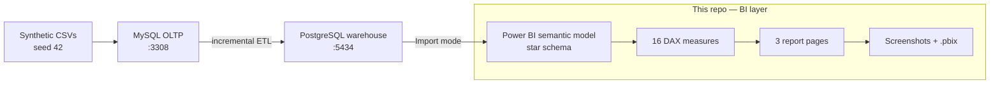

# Architecture

The dashboard is the presentation layer of a larger analytics stack. This page explains where the
boundary sits, how a row travels from a synthetic CSV to a KPI card, and why the model and report are
shaped the way they are.

The short version: the platform repo produces a trustworthy star-schema warehouse; this repo turns it
into a small, fast semantic model and a three-page report that reconciles to the source numbers.

## At a glance

| Layer | Choice |
|---|---|
| Repository scope | BI layer only: Power Query, semantic model, DAX, report, theme, evidence |
| Upstream | `ecommerce-data-platform-practice-project` |
| Warehouse | PostgreSQL 16 on `localhost:5434`, star schema |
| Semantic model | One fact, four dimensions, four single-direction relationships |
| Date handling | `dim_date` marked as date table; `MonthStart` calculated column |
| Report | Three pages on a 1280 × 720 canvas |
| Storage mode | **Import** |
| Measure count | 16 across Core, Time, Quality, and Share |
| Data | Synthetic, seed 42, 2024 only |
| Status | Complete and reconciled, verified 2026-10-20 |

## What this repo owns

| In scope | Out of scope |
|---|---|
| Power Query connection and typing | Synthetic data generation |
| Star-schema relationships and date table | MySQL OLTP and ETL |
| DAX measures and business rules | Warehouse SQL and schema creation |
| Three report pages and theme | Data quality tests in the platform repo |
| Screenshots, `.pbix`, documentation | Production gateway and scheduled refresh |

That boundary is deliberate. The report can be reviewed without rebuilding the platform, and the
platform can change its internals as long as the five warehouse tables keep their contract.

## Data flow

### The hand-off

1. The platform generates synthetic CSVs and loads MySQL.
2. Its incremental, watermarked ETL builds the PostgreSQL star schema.
3. Power BI imports five tables — `fact_sales` and the four dimensions — and leaves `etl_watermark`
   behind.
4. Power Query types the columns; the model adds `MonthStart`; DAX enforces the business rules.
5. The report presents the result, and the validation tables prove it still matches the source KPIs.

> **Checkpoint:** after a refresh, the report should still show **$7,261.50** revenue from **99**
> non-cancelled orders and **448** units. If not, stop and use the
> [troubleshooting table](spec.md#17-troubleshooting) before changing the model.

## Components

### Warehouse

Five tables are loaded: `fact_sales` and `dim_date`, `dim_customer`, `dim_product`, `dim_channel`.
`etl_watermark` is ETL bookkeeping and is deliberately **not** loaded. The fact grain is one row per
order line; `line_amount = quantity × unit_price`. See the
[data dictionary](../data/README.md) and [data model](data-model.md).

### Semantic model

One fact table, four dimensions, and four single-direction relationships on integer keys. `dim_date`
is marked as the date table using `full_date`. A calculated `MonthStart` column (`DATE(year, month, 1)`)
gives one row per month for the monthly axes and `DATEADD`-based measures. Keys are hidden from the
report view; `month_name` and `day_name` are sorted by their numeric columns.

The grain is deliberately simple: every relationship is one-to-many, and every measure starts from the
same fact. There are no bridge tables, many-to-many paths, or fact-to-fact joins to reason about.

### Measures

Sixteen measures in four display folders:

| Folder | Measures |
|---|---|
| **Core** | Total Revenue · Orders · Units Sold · AOV · Active Customers · Revenue per Customer · Avg Selling Price |
| **Time** | Revenue PM · MoM % · Latest Month MoM % · Revenue PY · YoY % · Revenue Running Total |
| **Quality** | Cancelled Order % |
| **Share** | Revenue % of Total · Product Rank |

The full catalogue — purpose, format, expected value, and DAX notes — is in [measures.md](measures.md).
The source of truth is [`dax/measures.dax`](../dax/measures.dax).

### Report

| Page | Question | Visuals |
|---|---|---|
| **Executive** | How much did we sell, and where? | 5 KPI cards · revenue by month · category bar · channel donut · channel slicer |
| **Trends** | How is revenue moving? | revenue line · orders column · monthly matrix with MoM · cumulative area · latest-month MoM and cancellation cards · channel slicer |
| **Products & Customers** | What drives revenue? | Top 5 products · category treemap · country bar · Top 10 customers table · Avg Selling Price card · category/country slicers |

The finished pages are in [`screenshots/`](../screenshots). The report file is
[`powerbi/beanstream-kpi.pbix`](../powerbi/beanstream-kpi.pbix).

### Theme

A small JSON theme sets the brown/cream/green palette, typography, and page background. It is applied
once in Power BI Desktop and does not affect number formats or display units.

## Design decisions

### Import mode

The dataset is small (120 orders, 448 units, $7,261.50 revenue), so **Import** mode keeps the report
fast and self-contained. There is no gateway, no query-folding requirement, and no live connection to
break.

**Trade-off:** the report is a snapshot until someone refreshes it. For a production warehouse, the
next step would be scheduled refresh or DirectQuery with a gateway.

### Star schema, single direction

Four dimensions filter one fact table; every relationship is one-to-many and single-direction. This
avoids ambiguous filter paths and keeps measure behaviour predictable. There are no fact-to-fact or
many-to-many relationships.

**Trade-off:** some questions may need a new relationship or a carefully written measure. The model
stays easier to audit as a result.

### Cancelled orders remain in the fact

Cancelled orders are **not** filtered in Power Query. They stay in `fact_sales` so cancellation remains
analysable, and every revenue, order, unit, and customer measure excludes them with
`CALCULATE ( ..., fact_sales[order_status] <> "cancelled" )`. The quality measure `Cancelled Order %`
uses the full order population: **21 cancelled of 120 total = 17.5%**.

**Trade-off:** every measure that touches the fact must remember the filter. The alternative — deleting
the rows — would erase a useful quality signal. The measure catalogue makes the rule explicit.

### Date table and `MonthStart`

`dim_date` is marked with `full_date`, a contiguous daily date column. A separate `MonthStart` column
holds the first day of each month. Monthly axes use `MonthStart`, not `month_name`; `DATEADD` needs a
date filter, and a text month name would leave `MoM %` blank. This one decision is the difference
between a working monthly trend and an empty visual.

**Trade-off:** the model carries one extra calculated column. It buys reliable time intelligence and
consistent month labels across every page.

### YoY is modelled, not shown

The warehouse covers **2024 only**, so `Revenue PY` and `YoY %` are intentionally blank. They remain in
the model for completeness and are not placed on a page. The Trends page uses month-over-month, a
latest-month card, and a running total instead. A bare `MoM %` card would show the grand-total artifact
(December ÷ January–November); `Latest Month MoM %` selects the last visible month and reports
**+190.03%**.

### Measures over calculated columns

Apart from `MonthStart`, the model uses measures rather than calculated columns for business logic.
Measures are reusable across pages and slicers, keep the model small, and avoid storing row-level
results that change with context.

### Page design and accessibility

Pages use a 1280 × 720 canvas, consistent margins, a single donut, and no 3D visuals. Every visual has
alt text; tab order runs title → cards → charts → slicers. KPI cards are set not to cross-filter when a
chart is clicked. Screenshots are page-only — no ribbon, tabs, tooltips, or cursor.

## Refresh and credentials

| Setting | Value |
|---|---|
| Server | `localhost:5434` |
| Database | `warehouse` |
| User / password | `learner` / `learner` |
| Mode | **Import** |

After the platform's `make etl`, open the `.pbix` and choose **Home → Refresh**. The connection is the
platform repo's local default; change it if your `.env` uses different values.

## Limitations

- Synthetic data only; no real customers, orders, or revenue.
- 2024 only; prior-year measures are blank.
- No delivery dates, invoices, or payments — so no on-time rate or receivables ageing.
- No row-level security, scheduled refresh, or published report link yet.
- `Active Customers` is **39** (customers in the fact table), not 40 (dimension rows); that is expected.

## Further work

- Publish to the Power BI service with a scheduled refresh.
- Add row-level security by country.
- Add incremental refresh for a larger warehouse.
- Move the marts to a cloud warehouse and benchmark refresh/query time.
- Add a deployment pipeline and a report usage/telemetry review.

## Related documents

| Document | Why read it |
|---|---|
| [Build guide](spec.md) | Reproduce the architecture step by step |
| [Data model](data-model.md) | Grain, keys, relationships, and date table |
| [Measure catalogue](measures.md) | Every DAX measure and its expected value |
| [Data dictionary](../data/README.md) | Source tables, columns, and caveats |
| [Case study](../case-study.md) | The project in portfolio form |
