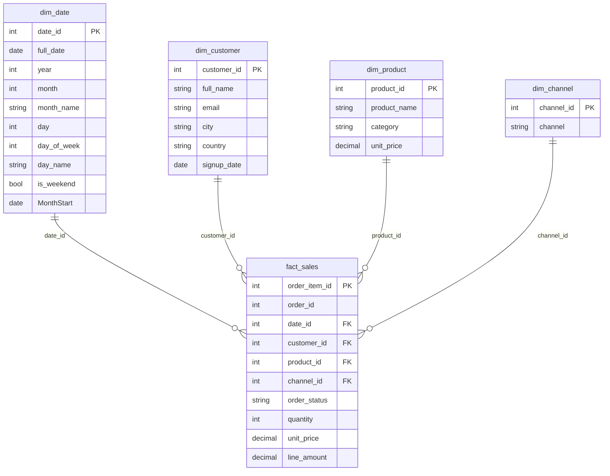

# Data model

The semantic model is deliberately small: one fact table, four dimensions, and a marked date table.
Everything the report does — revenue, orders, monthly trends, product rank — starts from the same
order-line grain.

This page documents that grain, the relationships that filter it, and the rules the measures rely on.

## At a glance

| Property | Choice |
|---|---|
| Fact table | `fact_sales` |
| Dimensions | `dim_date`, `dim_customer`, `dim_product`, `dim_channel` |
| Fact grain | One row per order line (`order_item_id`) |
| Relationships | Four, all one-to-many and single-direction |
| Date table | `dim_date`, marked on `full_date` |
| Monthly axis | `MonthStart` (`DATE(year, month, 1)`) |
| Measure groups | Core · Time · Quality · Share |
| Storage mode | Import |
| Data coverage | 2024, synthetic, seed 42 |

`etl_watermark` is ETL bookkeeping and is **not** loaded. `quarter` exists in the source but is not used
by the report. Types shown in the ERD are illustrative — see the [data dictionary](../data/README.md)
for the source columns and the [build guide](spec.md#4-clean-in-power-query) for Power Query types.

## How one sale becomes a metric

A single order can contain several products, so the warehouse stores **one fact row per order line**,
not one row per order. That choice keeps product, category, and quantity analysis possible without
splitting a single order into an ambiguous wide row.

| Step | What happens |
|---|---|
| 1 | A line lands in `fact_sales` with `order_id`, `order_item_id`, keys, quantity, price, and status |
| 2 | Dimensions filter the fact: date, customer, product, channel |
| 3 | `Total Revenue` sums `line_amount` for non-cancelled lines |
| 4 | `Orders` counts **distinct `order_id`**, not fact rows |
| 5 | `MonthStart` groups the result into months for time intelligence |
| 6 | The report presents the same fact at three levels: executive summary, trend, and product/customer detail |

That is why a report can show **99 orders** and **448 units** from the same fact table: one order can
contain multiple lines and multiple units. It is also why `Orders` is a distinct count while `Units
Sold` is a sum.

## Star schema



## Grain and keys

| Table | Grain | Key |
|---|---|---|
| `fact_sales` | One row per order line | `order_item_id` |
| `dim_date` | One row per calendar date | `date_id` (YYYYMMDD) |
| `dim_customer` | One row per customer | `customer_id` |
| `dim_product` | One row per product | `product_id` |
| `dim_channel` | One row per channel | `channel_id` |

`line_amount = quantity × unit_price`; `order_status` ∈ `{completed, shipped, pending, cancelled}`.

## Relationships

| From | To | Key | Cardinality | Direction |
|---|---|---|---|---|
| `dim_date` | `fact_sales` | `date_id` | One to many | Single |
| `dim_customer` | `fact_sales` | `customer_id` | One to many | Single |
| `dim_product` | `fact_sales` | `product_id` | One to many | Single |
| `dim_channel` | `fact_sales` | `channel_id` | One to many | Single |

Four relationships, no many-to-many or fact-to-fact paths. Dimension keys are hidden from the report
view; they remain available to the measures.

**Why single direction?** A dimension filters the fact, never the other way around. That makes filter
propagation predictable and prevents ambiguous paths as the model grows. The trade-off is that a
question requiring a dimension-to-dimension filter needs an explicit measure or a model change, rather
than an accidental relationship.

## Date table

`dim_date` is marked as the date table with `full_date`, a contiguous daily column. `month_name` is
sorted by `month`; `day_name` by `day_of_week`.

`MonthStart` is a calculated column:

```dax
MonthStart = DATE ( dim_date[year], dim_date[month], 1 )
```

It gives one row per month for the line, column, matrix, and area axes, and it makes
`DATEADD ( dim_date[MonthStart], -1, MONTH )` reliable. A text `month_name` axis would make `MoM %`
blank because `DATEADD` needs a date filter.

> **Do not mark `MonthStart` as the date table.** Keep `full_date` as the marked date column; use
> `MonthStart` for the monthly axes and time-intelligence measures.

## Measure groups

| Folder | Measures | Notes |
|---|---|---|
| **Core** | Total Revenue · Orders · Units Sold · AOV · Active Customers · Revenue per Customer · Avg Selling Price | Cancelled orders excluded |
| **Time** | Revenue PM · MoM % · Latest Month MoM % · Revenue PY · YoY % · Revenue Running Total | `MonthStart` for time intelligence |
| **Quality** | Cancelled Order % | Denominator includes all orders |
| **Share** | Revenue % of Total · Product Rank | Respects slicers via `ALLSELECTED` |

The complete catalogue — including format strings and expected values — is in [measures.md](measures.md).

## Rules

- **Cancelled orders stay in the fact table** and are excluded in measures, not in Power Query, so
  cancellation remains analysable.
- **Revenue** is `SUM(line_amount)` over non-cancelled lines.
- **Orders** is a distinct count of `order_id` over non-cancelled lines.
- **Active Customers** is a distinct count of `customer_id` in the fact table; **39** is expected, while
  `dim_customer` has **40** rows.
- The warehouse covers **2024 only**; `Revenue PY` / `YoY %` are blank by design.
- All data is synthetic, generated by the platform repo with seed 42.

## Expected validation

| Check | Expected | Why it matters |
|---|---:|---|
| Revenue | **$7,261.50** | Proves the fact and revenue filter reconcile |
| Orders | **99** | Proves distinct order counting, not line counting |
| Units | **448** | Proves quantity aggregation |
| Active customers | **39** | Proves fact-based customer counting |
| `dim_customer` rows | **40** | Explains the 39 vs 40 difference |
| Products | **12** | Confirms the product dimension loaded fully |
| Cancelled rate | **17.5%** | Proves the quality measure uses the full population |
| Latest month MoM | **+190.03%** | Proves `MonthStart` time intelligence works |

The full reconciliation is in [Build guide §12](spec.md#12-reconcile).

## Why this model

The star schema keeps the fact narrow and the dimensions descriptive. A single fact grain makes every
measure a straightforward aggregation, and single-direction relationships remove ambiguity. Keeping
cancelled orders in the fact preserves a real business signal without contaminating revenue: the
quality measure can report **17.5%** cancellation while the top-line cards stay clean.

It also keeps the report fast. Import mode plus a small star schema means no gateway, no live query
latency, and no need for a bridge table in a 120-order dataset.

## Full dictionary

Column-level details, source tables, expected checks, and caveats are in [`data/README.md`](../data/README.md).
