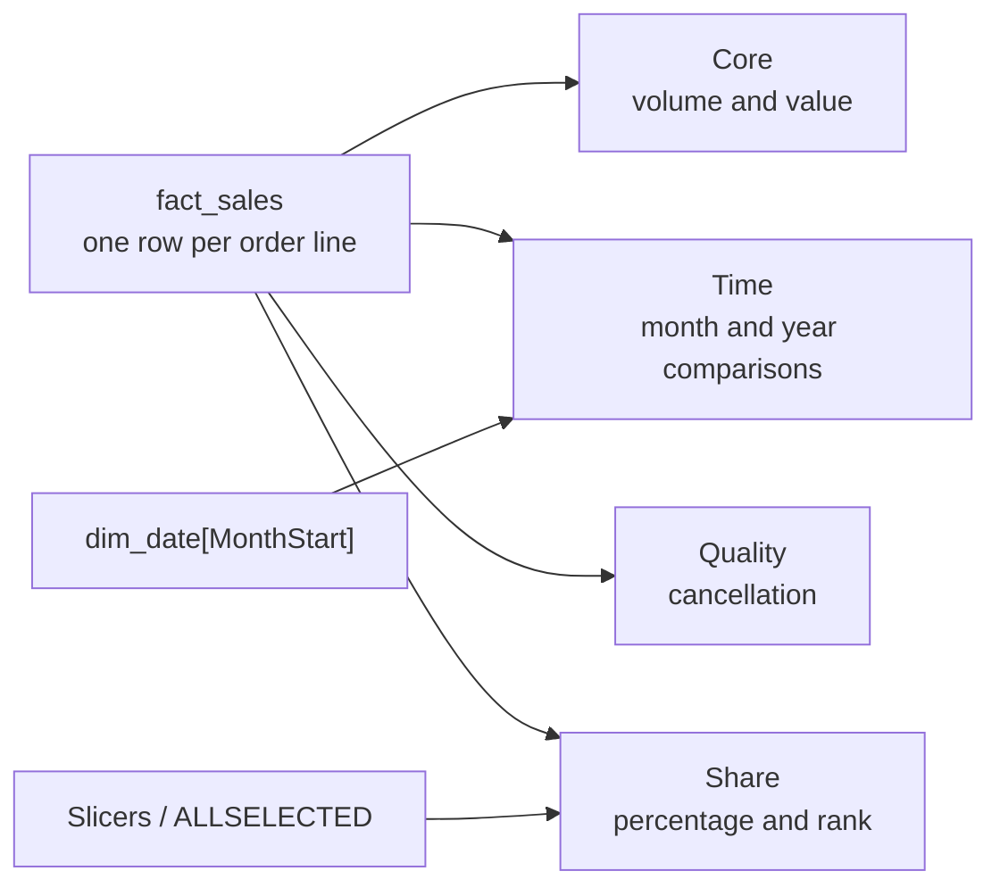

# Measure catalogue

The 16 measures are the report's contract with the warehouse. They turn order lines into revenue,
orders, units, and time-based comparisons — and they apply one rule consistently: **cancelled orders
are excluded inside the measure, not in Power Query.**

This page is the reference for what each measure does, how it is formatted, what it should return, and
where the subtle parts live.

## At a glance

| Property | Detail |
|---|---|
| Measures | **16** |
| Display folders | **Core · Time · Quality · Share** |
| Source of truth | [`dax/measures.dax`](../dax/measures.dax) |
| Revenue filter | `order_status <> "cancelled"` inside measures |
| Time intelligence | `MonthStart`, not `month_name` |
| Reference total | **$7,261.50** from **99** orders and **448** units |
| Cancellation | **21 ÷ 120 = 17.5%** |
| Status | Validated 2026-10-20 |

## How the measures fit together



## Choose the measure

| Question | Measure | Watch out for |
|---|---|---|
| How much did we sell? | `Total Revenue` | Excludes cancelled lines |
| How many orders? | `Orders` | Distinct `order_id`, not fact rows |
| How many units? | `Units Sold` | One order can contain many units |
| What is the average order? | `AOV` | Revenue ÷ orders |
| How many customers bought? | `Active Customers` | **39**, not 40 dimension rows |
| How much per customer? | `Revenue per Customer` | Uses active customers, not dimension rows |
| What is the average unit price? | `Avg Selling Price` | Revenue ÷ units |
| How does this month compare? | `MoM %` / `Revenue PM` | Requires a date axis |
| What is the latest month's change? | `Latest Month MoM %` | Avoids the grand-total artifact |
| How does this year compare? | `YoY %` / `Revenue PY` | Blank by design — 2024 only |
| How much have we accumulated? | `Revenue Running Total` | Respects slicers and visible period |
| How much is cancelled? | `Cancelled Order %` | Denominator is **all** orders |
| What share is this product? | `Revenue % of Total` | Recomputes within slicers |
| Which product is biggest? | `Product Rank` | Rank is by revenue |

## Full catalogue

| Measure | Folder | Format | Expected | What it does |
|---|---|---|---|---|
| `Total Revenue` | Core | `$#,##0.00` | **7,261.50** | Sum of non-cancelled `line_amount` |
| `Orders` | Core | `#,##0` | **99** | Distinct non-cancelled orders |
| `Units Sold` | Core | `#,##0` | **448** | Units on non-cancelled lines |
| `AOV` | Core | `$#,##0.00` | **73.35** | Revenue ÷ orders |
| `Active Customers` | Core | `#,##0` | **39** | Distinct customers in the fact (non-cancelled) |
| `Revenue per Customer` | Core | `$#,##0.00` | **186.19** | Revenue ÷ active customers |
| `Avg Selling Price` | Core | `$#,##0.00` | **16.21** | Revenue ÷ units |
| `Revenue PM` | Time | `$#,##0.00` | prior month | Prior month via `DATEADD` on `MonthStart` (March → 933.00) |
| `MoM %` | Time | `0.0%` | Mar **−72.9%**, Oct **+226.0%** | Month-over-month change |
| `Latest Month MoM %` | Time | `0.00%` | **190.03%** | MoM for the last visible month (December) |
| `Revenue PY` | Time | `$#,##0.00` | blank | Prior-year revenue; 2024-only source |
| `YoY %` | Time | `0.0%` | blank | Year-over-year change; 2024-only source |
| `Revenue Running Total` | Time | `$#,##0.00` | **7,261.50** at Dec | Cumulative revenue for the visible period |
| `Cancelled Order %` | Quality | `0.0%` | **17.5%** | Cancelled orders ÷ all orders |
| `Revenue % of Total` | Share | `0.0%` | **100%** at total | Share of the visible total for Top-N visuals |
| `Product Rank` | Share | `#,##0` | 1 = top | Rank products by revenue |

The DAX source is organised in the same four groups, so the catalogue and the file are easy to compare.

## Design notes

### Cancelled orders

The fact table keeps cancelled orders so cancellation remains analysable. The measures exclude them
with a filter predicate:

```dax
Total Revenue =
CALCULATE (
    SUM ( fact_sales[line_amount] ),
    fact_sales[order_status] <> "cancelled"
)
```

`Cancelled Order %` is the exception: its denominator is **all** orders, so it reports
**21 ÷ 120 = 17.5%**. That is why the quality card can show a meaningful cancellation rate without
polluting revenue or order counts.

### Time intelligence

`Revenue PM` and `Revenue PY` use `MonthStart`, not `full_date` or `month_name`:

```dax
Revenue PM =
CALCULATE (
    [Total Revenue],
    DATEADD ( dim_date[MonthStart], -1, MONTH )
)
```

`MonthStart` has one row per month and is a real date column, so `DATEADD` works on every monthly axis.
A text month name would leave `MoM %` blank.

`Revenue PY` and `YoY %` are correct but blank with the 2024-only dataset. They stay in the model and
are not placed on a page.

### Latest month

A bare `MoM %` card on an unfiltered page computes the grand-total artifact — December revenue divided
by January–November — which is not a monthly trend. `Latest Month MoM %` selects the last visible month:

```dax
Latest Month MoM % =
VAR LastMonth =
    MAX ( dim_date[MonthStart] )
RETURN
    CALCULATE ( [MoM %], dim_date[MonthStart] = LastMonth )
```

On the full 2024 selection it reports **+190.03%** (December vs November).

### Running total

`Revenue Running Total` respects the slicers and the visible period:

```dax
Revenue Running Total =
CALCULATE (
    [Total Revenue],
    FILTER (
        ALLSELECTED ( dim_date[MonthStart] ),
        dim_date[MonthStart] <= MAX ( dim_date[MonthStart] )
    )
)
```

### Share and rank

`Revenue % of Total` uses `ALLSELECTED ()`, so a category or channel slicer recomputes the share within
the selection. `Product Rank` uses `RANKX` over the selected product names, which makes the Top 5
product list stable.

## Common pitfalls

| Symptom | Cause | Fix |
|---|---|---|
| Revenue card reads `$7.26K` | Automatic display units | Set **Display units → None** |
| `MoM %` is blank | Axis uses `month_name` or text | Put `MonthStart` on the axis |
| March MoM is wrong | Using `full_date` instead of `MonthStart` | Update the three time measures |
| Orders show 120 | Cancelled orders included | Check the measure filter; do not filter in Power Query |
| Active Customers shows 40 | Using dimension rows | Use the `Active Customers` measure; 39 is correct |
| Latest month card shows a huge change | Bare `MoM %` on an unfiltered page | Use `Latest Month MoM %` |
| Top-N share is wrong under a slicer | Hard-coded denominator | Use `Revenue % of Total` with `ALLSELECTED` |
| YoY is blank | Dataset is 2024 only | Expected; keep it off the page |

The build guide has the full [troubleshooting table](spec.md#17-troubleshooting).

## Formatting

- Revenue: `$#,##0.00` — USD is a display assumption; the synthetic generator does not encode a currency.
- Counts: `#,##0`.
- Percentages: `0.0%`; `Latest Month MoM %` uses `0.00%` to show the 190.03% value precisely.
- Display folders: **Core**, **Time**, **Quality**, **Share**.
- KPI cards: display units **None** so the total reads `$7,261.50`, not `$7.26K`.

## Validate the catalogue

After a model change, check these eight numbers before touching the pages:

| Check | Expected |
|---|---:|
| Revenue | **7,261.50** |
| Orders | **99** |
| Units | **448** |
| AOV | **73.35** |
| Active customers | **39** |
| Avg selling price | **16.21** |
| Cancelled order % | **17.5%** |
| Latest month MoM | **+190.03%** |

The full monthly and page-level checks are in [Build guide §6](spec.md#64-validate-the-measures-before-building-pages)
and [§12](spec.md#12-reconcile).

## Related documents

| Document | Why read it |
|---|---|
| [DAX source](../dax/measures.dax) | The executable definitions |
| [Data model](data-model.md) | Grain, relationships, and `MonthStart` |
| [Architecture](architecture.md) | Why the model is shaped this way |
| [Build guide](spec.md) | Reproduce the measures step by step |
