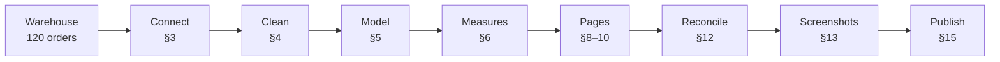

# Build guide — BeanStream Power BI KPI Dashboard

This guide documents how the report was built and how to reproduce it. Follow it top to bottom; each
step ends with a **check**.

The finished report is [`../powerbi/beanstream-kpi.pbix`](../powerbi/beanstream-kpi.pbix); the page
exports are in [`../screenshots/`](../screenshots/).

Architecture and design decisions: [architecture.md](architecture.md); data model:
[data-model.md](data-model.md); measure catalogue: [measures.md](measures.md).

## Who this is for

Use this guide to rebuild the report from the warehouse, audit how a finished page was made, or teach
the workflow. It assumes basic Power BI Desktop familiarity but explains the non-obvious parts. If you
only want to open the finished report, use the [README quickstart](../README.md) instead.

## Build at a glance

| Item | Detail |
|---|---|
| Outcome | Three-page `.pbix`, three screenshots, and a reconciled model |
| Starting point | Platform warehouse running on `localhost:5434` |
| Time | **2–3 hours** |
| Difficulty | Intermediate — comfortable with Power BI Desktop |
| Hard stop | **120** total orders · **99** non-cancelled · **$7,261.50** revenue |
| Final proof | Every row in [§12](#12-reconcile) matches |

## Build path



| Stage | Sections | Stop when… |
|---|---|---|
| Prepare the warehouse | [0](#0-deliverables)–[2](#2-start-and-verify-the-warehouse) | Source returns 120 / 99 / 7,261.50 |
| Connect and clean | [3](#3-connect-power-bi)–[4](#4-clean-in-power-query) | Five typed tables, no `etl_watermark` |
| Build the model | [5](#5-build-the-model) | Four single relationships, date table, `MonthStart` |
| Add measures | [6](#6-add-the-measures) | All 16 measures match their expected values |
| Build pages | [7](#7-apply-the-theme)–[10](#10-page-3--products--customers) | Three pages match the reference layouts |
| Polish and prove | [11](#11-interactions-and-polish)–[13](#13-export-the-screenshots) | Reconciliation passes, screenshots exported |
| Publish and wrap | [14](#14-documentation-and-evidence)–[19](#19-further-work) | Docs current, repository published |

**Three rules that prevent most problems:**

1. **Do not rename the tables.** The measures reference `fact_sales`, `dim_date`, `dim_customer`,
   `dim_product`, `dim_channel` exactly.
2. **Do not filter out cancelled orders in Power Query.** They stay in the fact table and are excluded
   inside the measures.
3. **Use `MonthStart` (created in §5) for every monthly axis that shows `MoM %`.** Do not use
   `month_name` there — `DATEADD` needs a date column.

**Layout is a suggestion.** The coordinates in §8–10 are one readable arrangement. Keep the same
visuals, fields, and checks; arrange them how they read best.

---

## 0. Deliverables

| Deliverable | Where |
|---|---|
| Power BI report, 3 pages | `powerbi/beanstream-kpi.pbix` |
| Three page screenshots | `screenshots/01-executive.png`, `02-trends.png`, `03-products.png` |
| Repo front page with screenshots + reconciliation | `README.md` |
| Portfolio write-up | `case-study.md` |
| Public GitHub repo | `github.com/malikb0/beanstream-powerbi` |

**Result:** the report refreshes cleanly, reconciles to the platform's KPI summary, and ships three
themed pages with alt text, the `.pbix`, screenshots, README, and case study.

---

## 1. Before you start

| Need | Check |
|---|---|
| Windows with **Power BI Desktop** (latest) | Open it once; sign-in is optional for local files |
| The platform repo cloned | Folder contains `docker-compose.yml`, `Makefile`, and the expected-reports folder |
| Docker Desktop running | `docker ps` works |
| Git | `git --version` works |
| GitHub account `malikb0` | You can create a repo |
| This repo cloned locally | `git status` works |
| ~2–3 hours | Do not rush the model or reconciliation |

---

## 2. Start and verify the warehouse

Open a terminal in the **platform repo** (the folder with `docker-compose.yml`):

```bash
make setup
make up
make seed
make etl
```

`make up` starts PostgreSQL on **5434** and MySQL on **3308**. The compose project is
`ecommerce-data-platform-practice-project`, so the containers are:

- `ecommerce-data-platform-practice-project-postgres-1`
- `ecommerce-data-platform-practice-project-mysql-1`

Verify the containers:

```bash
docker compose ps
```

Both should be running; PostgreSQL should be healthy.

### Verify the source numbers

Run this against the warehouse:

```bash
docker exec -it ecommerce-data-platform-practice-project-postgres-1 psql -U learner -d warehouse -c "SELECT COUNT(DISTINCT order_id) AS all_orders, COUNT(DISTINCT order_id) FILTER (WHERE order_status <> 'cancelled') AS paid_orders, ROUND(SUM(line_amount) FILTER (WHERE order_status <> 'cancelled'), 2) AS revenue FROM fact_sales;"
```

The command is one line (it works in bash/WSL and PowerShell). If `make`, `docker`, or `psql` is not on
your Windows PATH, run the whole section from WSL.

Expected:

| all_orders | paid_orders | revenue |
|---:|---:|---:|
| 120 | 99 | 7261.50 |

If you do not have `psql`, use pgAdmin/DBeaver (`localhost:5434`, db `warehouse`, `learner` / `learner`) or
rely on the Power BI cards in §6.

**Check:** 120 total orders, 99 non-cancelled, revenue 7,261.50. Do not continue until this matches.

---

## 3. Connect Power BI

1. Open **Power BI Desktop** → **Home → Get data → More…**
2. **Database → PostgreSQL database → Connect**.
3. Fill in:

   | Field | Value |
   |---|---|
   | Server | `localhost:5434` |
   | Database | `warehouse` |
   | Data Connectivity mode | **Import** |

4. Click **OK**. If asked for credentials, choose the **Database** tab:
   - User name: `learner`
   - Password: `learner`
   - Click **Connect**.
5. If Power BI warns that the connection is not encrypted, choose **Use an unencrypted connection**
   (this is a local Docker database).
6. In the **Navigator**, tick exactly these five tables:
   - `fact_sales`
   - `dim_date`
   - `dim_customer`
   - `dim_product`
   - `dim_channel`

   **Do not tick `etl_watermark`.**
7. Click **Transform Data** (not *Load*) so you can set types in §4.

**Check:** the Navigator lists the five tables; `etl_watermark` is unticked.

---

## 4. Clean in Power Query

You are now in the Power Query Editor. Work through each query.

### 4.1 Set column types

Select the column, then **Home → Data type** (or click the type icon in the column header).

| Table | Column | Type |
|---|---|---|
| `fact_sales` | `order_item_id`, `order_id`, `date_id`, `customer_id`, `product_id`, `channel_id`, `quantity` | Whole Number |
| `fact_sales` | `unit_price`, `line_amount` | Decimal Number |
| `fact_sales` | `order_status` | Text |
| `dim_date` | `date_id`, `year`, `month`, `day`, `day_of_week` | Whole Number |
| `dim_date` | `full_date` | Date |
| `dim_date` | `is_weekend` | True/False |
| `dim_date` | `month_name`, `day_name` | Text |
| `dim_customer` | `customer_id` | Whole Number |
| `dim_customer` | `signup_date` | Date |
| `dim_customer` | `full_name`, `email`, `city`, `country` | Text |
| `dim_product` | `product_id` | Whole Number |
| `dim_product` | `unit_price` | Decimal Number |
| `dim_product` | `product_name`, `category` | Text |
| `dim_channel` | `channel_id` | Whole Number |
| `dim_channel` | `channel` | Text |

Leave `dim_date[quarter]` as Power BI infers it — it is not used in any visual.

### 4.2 Trim text

For each column below: select it → **Transform → Format → Trim**.

- `dim_customer[full_name]`, `dim_customer[email]`, `dim_customer[city]`, `dim_customer[country]`
- `dim_product[product_name]`, `dim_product[category]`
- `dim_channel[channel]`
- `fact_sales[order_status]`
- `dim_date[month_name]`, `dim_date[day_name]`

### 4.3 Do not do these

- Do **not** filter out `order_status = "cancelled"`.
- Do **not** rename the queries/tables.
- Do **not** remove columns (the model and measures expect them).

Click **Home → Close & Apply**.

**Check:** the Data pane lists the five tables with the names above.

---

## 5. Build the model

### 5.1 Relationships

Go to **Model view** (the icon on the left rail). You need four relationships:

| From (dimension) | To (fact) | Key | Cardinality | Direction |
|---|---|---|---|---|
| `dim_date` | `fact_sales` | `date_id` | One to many | Single |
| `dim_customer` | `fact_sales` | `customer_id` | One to many | Single |
| `dim_product` | `fact_sales` | `product_id` | One to many | Single |
| `dim_channel` | `fact_sales` | `channel_id` | One to many | Single |

If Power BI created them automatically, click each line and verify the cardinality and direction. If any
are missing, drag the key from the dimension onto the matching key in `fact_sales`. Delete any extra or
many-to-many relationships.

### 5.2 Mark the date table

Select `dim_date` → **Table tools → Mark as date table** → choose `full_date`. If the button is greyed
out, click the table in Model view first. `full_date` must be a Date column with unique values.

### 5.3 Sort the names

Go to **Data view** → `dim_date`:

- Select `month_name` → **Column tools → Sort by column → `month`**.
- Select `day_name` → **Column tools → Sort by column → `day_of_week`**.

### 5.4 Hide the keys (optional, keeps the field list clean)

In Model view, click the eye icon next to `dim_date[date_id]`, `dim_customer[customer_id]`,
`dim_product[product_id]`, `dim_channel[channel_id]`. The relationships still work.

### 5.5 Turn off auto date/time

**File → Options and settings → Options → Current file → Data load → Time intelligence** → untick
**Auto date/time** → OK. This removes hidden date tables.

### 5.6 Create `MonthStart` (required for MoM)

Still in **Data view**, select `dim_date` → **Table tools → New column** → paste:

```dax
MonthStart = DATE ( dim_date[year], dim_date[month], 1 )
```

Press Enter. Then select `MonthStart` → **Column tools → Format** → type `mmm yyyy`.

Why: one row per month, a real date column, clean axis labels, and `DATEADD` works reliably. **Do not**
mark `MonthStart` as the date table — keep `full_date` as the marked date column.

**Check:** Model view shows four single-direction relationships; `dim_date` has a date-table icon;
`MonthStart` appears in `dim_date`.

---

## 6. Add the measures

The 16 measures are in [`../dax/measures.dax`](../dax/measures.dax). If your measures already exist, keep
them and update the three time measures in §6.3.

### 6.1 Where to put them

If starting fresh, create a measures table:

1. **Home → Enter Data**.
2. Name: `_Measures`; column: `Placeholder`; one row: `x`.
3. **Load**. Hide `Placeholder` (right-click → **Hide in report view**).

Then select `_Measures` before creating each measure. If you already added measures to `fact_sales`, that
is fine too — the table does not matter.

### 6.2 Add one measure at a time

For each measure:

1. Select `_Measures` (or your measures table) in the **Data** pane.
2. **Modeling → New measure**.
3. Copy **one block** from `dax/measures.dax` (the name and expression), paste, press Enter.
4. In **Measure tools**, set **Format** and **Display folder** from the table below.

| Measure | Format | Folder | Expected value |
|---|---|---|---|
| `Total Revenue` | Currency `$`, 2 dp | Core | **7,261.50** |
| `Orders` | Whole number | Core | **99** |
| `Units Sold` | Whole number | Core | **448** |
| `AOV` | Currency `$`, 2 dp | Core | **73.35** |
| `Active Customers` | Whole number | Core | **39** |
| `Revenue per Customer` | Currency `$`, 2 dp | Core | **186.19** |
| `Avg Selling Price` | Currency `$`, 2 dp | Core | **16.21** |
| `Revenue PM` | Currency `$`, 2 dp | Time | prior month (e.g. March → 933.00) |
| `MoM %` | Percentage, 1 dp | Time | March **−72.9%**, October **+226.0%** |
| `Latest Month MoM %` | Percentage, 2 dp | Time | December **+190.03%** |
| `Revenue PY` | Currency `$`, 2 dp | Time | blank (one year of data) |
| `YoY %` | Percentage, 1 dp | Time | blank (one year of data) |
| `Revenue Running Total` | Currency `$`, 2 dp | Time | December = **7,261.50** |
| `Cancelled Order %` | Percentage, 1 dp | Quality | **17.5%** |
| `Revenue % of Total` | Percentage, 1 dp | Share | 100.0% at the total |
| `Product Rank` | Whole number | Share | 1 = top product |

### 6.3 Update the three time measures to use `MonthStart`

If your measures currently use `dim_date[full_date]` for time intelligence, edit these three (select the
measure → formula bar → replace `full_date` with `MonthStart` → Enter):

```dax
Revenue PM =
CALCULATE (
    [Total Revenue],
    DATEADD ( dim_date[MonthStart], -1, MONTH )
)
```

```dax
Revenue PY =
CALCULATE (
    [Total Revenue],
    SAMEPERIODLASTYEAR ( dim_date[MonthStart] )
)
```

```dax
Revenue Running Total =
CALCULATE (
    [Total Revenue],
    FILTER (
        ALLSELECTED ( dim_date[MonthStart] ),
        dim_date[MonthStart] <= MAX ( dim_date[MonthStart] )
    )
)
```

### 6.4 Validate the measures before building pages

Create a **Table** visual with:

- `dim_date[MonthStart]`
- `Total Revenue`
- `Orders`
- `Units Sold`

Check:

| Month | Revenue | Orders | Units |
|---|---:|---:|---:|
| Jan 2024 | 905.50 | 10 | 61 |
| Feb 2024 | 933.00 | 10 | 50 |
| Mar 2024 | 252.75 | 4 | 15 |
| Apr 2024 | 333.25 | 4 | 24 |
| May 2024 | 665.50 | 11 | 44 |
| Jun 2024 | 335.50 | 5 | 18 |
| Jul 2024 | 427.50 | 7 | 29 |
| Aug 2024 | 629.50 | 9 | 33 |
| Sep 2024 | 390.50 | 8 | 28 |
| Oct 2024 | 1,273.00 | 15 | 78 |
| Nov 2024 | 286.00 | 5 | 18 |
| Dec 2024 | 829.50 | 11 | 50 |
| **Total** | **7,261.50** | **99** | **448** |

Then check the cards:

- `Active Customers` = **39** (not 40 — 40 is the number of rows in `dim_customer`).
- `Cancelled Order %` = **17.5%** (21 cancelled of 120 total).
- `Revenue PY` / `YoY %` = **blank** — expected, the data is 2024 only.
- `MoM %` for March = **−72.9%**; for October = **+226.0%**; for January = **blank**.

Delete the test table.

**Check:** every number above matches. If not, fix the model/measures before building pages.

---

## 7. Apply the theme

1. **View → Themes → Browse for themes**.
2. Choose `theme/beanstream-theme.json`.
3. Click **Open**.

The palette is brown/cream/green on white. The theme does not change number formats or display units.

**Check:** visuals use the brown/cream palette; the page background is white.

---

## 8. Page 1 — Executive

The layout below is the reference used in the finished report. It assumes a **1280 × 720** canvas; keep
the proportions if yours differs.

### 8.1 Layout

| Element | X | Y | W | H |
|---|---:|---:|---:|---:|
| Title | 40 | 24 | 600 | 40 |
| Subtitle | 40 | 66 | 600 | 24 |
| KPI cards (5) | 40, 283, 526, 769, 1012 | 110 | 228 | 110 |
| Line — revenue by month | 40 | 250 | 320 | 420 |
| Bar — revenue by category | 376 | 250 | 320 | 420 |
| Donut — revenue by channel | 712 | 250 | 320 | 420 |
| Channel slicer | 1048 | 250 | 192 | 220 |
| Footer text | 1048 | 490 | 192 | 60 |

Title: **BeanStream — Executive KPI**. Subtitle: **2024 · synthetic data · non-cancelled revenue**.

### 8.2 Visuals

| Visual | Type | Fields | Title | Format |
|---|---|---|---|---|
| Total Revenue | Card | `Total Revenue` | (label from measure) | **Display units: None**, 2 dp |
| Orders | Card | `Orders` | (label) | Whole number |
| Units Sold | Card | `Units Sold` | (label) | Whole number |
| Avg Order Value | Card | `AOV` renamed | (label) | Currency, 2 dp |
| Active Customers | Card | `Active Customers` | (label) | Whole number |
| Revenue by month | Line | X `MonthStart`, Y `Total Revenue` | **Revenue by month (2024)** | Markers on; data labels off |
| Revenue by category | Bar | Y `dim_product[category]`, X `Total Revenue` | **Revenue by category** | Sort descending; data labels on |
| Revenue by channel | Donut | Legend `dim_channel[channel]`, Values `Total Revenue` | **Revenue by channel** | Detail labels %; legend on |
| Channel slicer | Slicer | `dim_channel[channel]` | **Channel** | Tile style; header on |

**Line axis:** use `MonthStart` (not year + `month_name`) for clean month labels. The Executive page has
no time-intelligence measure, so either works, but `MonthStart` keeps all pages consistent.

### 8.3 Formatting details

1. **Exact revenue.** Select the Total Revenue card → **Format visual → Callout value → Display units →
   None** → decimal places **2**. It reads **$7,261.50**.
2. **Titles.** Select each chart → **Format → Title → Text** and set exactly:
   - `Revenue by month (2024)`
   - `Revenue by category`
   - `Revenue by channel`
3. **Slicers.** There is no year slicer (the data is 2024 only). Select the channel slicer →
   **Format → Slicer header → Text → `Channel`**.
4. **AOV label.** In the card's **Values** well, click `AOV` → **Rename for this visual → `Avg Order
   Value`**. The measure itself stays `AOV`.
5. **Fill the bottom.** Set the line/bar/donut heights to **400–420 px**; align tops and bottoms; add the
   footer: `Source: BeanStream warehouse · synthetic · 2024` (small, grey).

### 8.4 Alt text

For every visual: **Format → General → Alt text → On**, then describe it, e.g. *“Line chart of monthly
revenue, peaking in October at $1,273.”* Do not rely on colour alone.

**Check:** the page matches the reference layout; revenue is `$7,261.50`; titles are plain English; no
year slicer; no large empty area at the bottom.

---

## 9. Page 2 — Trends

Add a new page and rename it **Trends**.

### 9.1 Layout

| Element | X | Y | W | H |
|---|---:|---:|---:|---:|
| Title | 40 | 24 | 600 | 40 |
| Subtitle | 40 | 66 | 600 | 24 |
| Latest Month MoM % card | 40 | 90 | 200 | 90 |
| Cancelled Order % card | 255 | 90 | 200 | 90 |
| Channel slicer | 1048 | 24 | 192 | 70 |
| Line — revenue | 40 | 200 | 580 | 230 |
| Column — orders | 640 | 200 | 600 | 230 |
| Matrix — monthly | 40 | 450 | 580 | 230 |
| Area — cumulative | 640 | 450 | 600 | 230 |
| Page note | 40 | 690 | 1200 | 24 |

### 9.2 Visuals

| Visual | Type | Fields | Title |
|---|---|---|---|
| Revenue by month | Line | X `MonthStart`, Y `Total Revenue` | Revenue by month (2024) |
| Orders by month | Column | X `MonthStart`, Y `Orders` | Orders by month |
| Monthly performance | Matrix | Rows `MonthStart`; Values `Total Revenue`, `MoM %`, `Orders` | Monthly performance |
| Cumulative revenue | Area | X `MonthStart`, Y `Revenue Running Total` | Cumulative revenue |
| Latest month MoM | Card | `Latest Month MoM %` | (label) |
| Cancelled orders | Card | `Cancelled Order %` | (label) |
| Channel slicer | Slicer | `dim_channel[channel]` | Channel |

**Do not put a bare `MoM %` card on the page** — with no month context it computes the grand-total MoM
(December ÷ January–November), which is not a monthly trend. The matrix carries the monthly MoM. The
`Latest Month MoM %` measure picks the last visible month (December) and shows +190.03%; put that in the
card instead.

**Critical:** put `MonthStart` on the line/column/area X-axes and the matrix rows. Do **not** use
`month_name` or a text date on this page — `MoM %` will go blank.

Turn off the matrix total row (**Format → Row subtotals → Off**); a total MoM is meaningless.

Optional: conditional-format `MoM %` (red for negative, green for positive) via **Format → Cell elements
→ Font colour → Conditional formatting → Rules**.

### 9.3 Page note

**Insert → Text box**: `Single year of data (2024) — YoY is not meaningful.` Small, grey.

### 9.4 Validate

| Month | Revenue | Orders | MoM % |
|---|---:|---:|---:|
| Jan | 905.50 | 10 | *(blank)* |
| Feb | 933.00 | 10 | +3.0% |
| Mar | 252.75 | 4 | **−72.9%** |
| Apr | 333.25 | 4 | +31.8% |
| May | 665.50 | 11 | +99.7% |
| Jun | 335.50 | 5 | −49.6% |
| Jul | 427.50 | 7 | +27.4% |
| Aug | 629.50 | 9 | +47.3% |
| Sep | 390.50 | 8 | −38.0% |
| Oct | 1,273.00 | 15 | **+226.0%** |
| Nov | 286.00 | 5 | −77.5% |
| Dec | 829.50 | 11 | +190.0% |

**Check:** March and October match the bold values; January is blank; the area ends at **7,261.50**;
`Cancelled Order %` shows **17.5%**; `Latest Month MoM %` shows **+190.03%** (December vs November).

---

## 10. Page 3 — Products & Customers

Add a new page and rename it **Products & Customers**.

### 10.1 Layout

| Element | X | Y | W | H |
|---|---:|---:|---:|---:|
| Title | 40 | 24 | 560 | 40 |
| Subtitle | 40 | 66 | 560 | 24 |
| Avg Selling Price card | 640 | 24 | 160 | 70 |
| Category slicer | 820 | 24 | 180 | 70 |
| Country slicer | 1020 | 24 | 220 | 70 |
| Top 5 products bar | 40 | 110 | 580 | 280 |
| Category treemap | 640 | 110 | 600 | 280 |
| Revenue by country bar | 40 | 410 | 580 | 240 |
| Top 10 customers table | 640 | 410 | 600 | 240 |
| Footer | 40 | 670 | 1200 | 24 |

Title: **Products & Customers**. Subtitle: **2024 · synthetic data**.

### 10.2 Visuals

| Visual | Type | Fields | Title |
|---|---|---|---|
| Top 5 products | Bar | Y `dim_product[product_name]`, X `Total Revenue`; tooltip `Revenue % of Total` | Top 5 products by revenue |
| Revenue by category | Treemap | Category `dim_product[category]`, Values `Total Revenue` | Revenue by category |
| Revenue by country | Bar | Y `dim_customer[country]`, X `Total Revenue` | Revenue by country |
| Top 10 customers | Table | `dim_customer[full_name]`, `dim_customer[country]`, `Total Revenue`, `Orders` | Top 10 customers |
| Avg Selling Price | Card | `Avg Selling Price` | (label) |
| Category slicer | Slicer | `dim_product[category]` | Category |
| Country slicer | Slicer | `dim_customer[country]` | Country |

**Sort the Top 5 bar descending by `Total Revenue`** (visual `…` → Sort axis → Total Revenue → Sort
descending). Turn off the table total row (**Format → Total row → Off**) or label it “Top 10 total” — it is
a subset, not total revenue.

### 10.3 Add the Top N filters

**Top 5 products:**

1. Select the product bar chart.
2. In the **Filters** pane, drag `dim_product[product_name]` into **Filters on this visual**.
3. **Filter type → Top N**.
4. Show top **5**; drag `Total Revenue` into **By value**; **Apply filter**.

**Top 10 customers:**

1. Select the table.
2. Drag `dim_customer[full_name]` into **Filters on this visual**.
3. **Filter type → Top N**; show top **10**; by `Total Revenue`; **Apply filter**.

Sort the country bar descending: visual **… → Sort axis → Total Revenue → Sort descending**.

### 10.4 Validate

- Sum of **all** category revenue (clear slicers) = **7,261.50**.
- Sum of **all** country revenue = **7,261.50**.
- `Avg Selling Price` = **$16.21**.
- The Top 5 / Top 10 are subsets; no value exceeds the total.
- Coffee should be the largest category; the app channel should be the largest channel (check on
  Executive).

**Check:** totals reconcile; filters show 5 and 10 rows; no duplicates in the customer table.

---

## 11. Interactions and polish

1. **Edit interactions.** Select each chart → **Format → Edit interactions**. Set the KPI cards to
   **None** so clicking a chart does not scramble the cards. Keep slicers filtering everything.
2. **Tab order.** **View → Selection → Tab order**; order: title → cards → charts → slicers.
3. **Alt text.** Every visual, every page.
4. **Align.** Select multiple visuals → **Format → Align → Top**, then **Distribute horizontally**.
5. **Do not** use 3D visuals or more than one donut.
6. **Titles** on every page and visual; consistent alignment and spacing.

**Check:** clicking a chart does not change the KPI cards; tab order is sensible.

---

## 12. Reconcile

Verified against the report:

| KPI | Expected | Dashboard | Match |
|---|---:|---:|:---:|
| Total Revenue (non-cancelled) | 7,261.50 | 7,261.50 | ✅ |
| Orders (non-cancelled) | 99 | 99 | ✅ |
| Units Sold | 448 | 448 | ✅ |
| AOV | 73.35 | 73.35 | ✅ |
| Active Customers | 39 | 39 | ✅ |
| Customers (`dim_customer` rows) | 40 | 40 | ✅ |
| Products (`dim_product` rows) | 12 | 12 | ✅ |
| Cancelled Order % | 17.5% | 17.5% | ✅ |

`Latest Month MoM %` (December vs November) is **+190.03%**. The dashboard values come from the
Executive/Trends cards and the dimension row counts; `Active Customers` = 39 is correct (40 is the
dimension row count).

**Check:** every row matches.

---

## 13. Export the screenshots

1. Save the report: **File → Save as** → `powerbi/beanstream-kpi.pbix`.
2. **View → Page view → Actual size**; close the Filters pane to maximise the canvas; click an empty
   area so nothing is selected.
3. Use **Windows Snipping Tool** (`Win + Shift + S`) → rectangular snip of the **page canvas** (not the
   whole window).
4. Save exactly:
   - `screenshots/01-executive.png`
   - `screenshots/02-trends.png`
   - `screenshots/03-products.png`

Do not include the Power BI ribbon, page tabs, or a mouse cursor. If a PNG is blurry, redo it at 100%
zoom.

**Check:** three readable PNGs with the exact filenames.

---

## 14. Documentation and evidence

The repository ships a linked documentation set. Keep these pages current when the model or report
changes; a stale number is worse than a missing one.

| Document | Purpose |
|---|---|
| [`README.md`](../README.md) | Status, screenshots, pages, key findings, validation, repo map |
| [`case-study.md`](../case-study.md) | Context, problem, build, decisions, result, links |
| [`docs/README.md`](README.md) | Documentation hub and reading paths |
| [`docs/architecture.md`](architecture.md) | Components, data flow, decisions, limits |
| [`docs/data-model.md`](data-model.md) | Grain, keys, relationships, date table |
| [`docs/measures.md`](measures.md) | All 16 measures, formats, expected values |
| [`data/README.md`](../data/README.md) | Source tables, columns, rules, expected checks |
| [`docs/publishing.md`](publishing.md) | Release runbook and repository settings |

If you rebuild this, keep the same structure and trace every number back to the source KPI summary.

---

## 15. Publish

See [`publishing.md`](publishing.md) for the repo description, topics, commit/push, pin, and social
preview.

---

## 16. Licence and attribution

MIT — see [`../LICENSE`](../LICENSE). All data is synthetic, generated by the
[ecommerce-data-platform-practice-project](https://github.com/malikb0/ecommerce-data-platform-practice-project)
with seed 42.

---

## 17. Troubleshooting

| Symptom | Likely cause | Fix |
|---|---|---|
| `make up` fails or 5434 is in use | Another Postgres/container | Stop it; `docker compose down`; change `.env` port |
| Power BI cannot connect | Wrong server/port/credentials/encryption | `localhost:5434`; `learner`/`learner`; unencrypted; container healthy |
| Navigator is empty | ETL not run or wrong schema | `make etl`; refresh; look in `public` |
| Tables have wrong names | You renamed the queries | Rename back to `fact_sales`, `dim_*` — the DAX depends on them |
| Relationships missing/wrong | Key types differ | Both keys Whole Number; create the relationship manually |
| “Mark as date table” greyed | Table not selected / no Date column | Select `dim_date` in Model view; `full_date` is Date |
| Month names sort A→Z | Not sorted | `month_name` → Sort by column → `month` |
| `MoM %` is blank | Axis uses `month_name`/text | Use `MonthStart`; edit the three time measures (§6.3) |
| Revenue card shows `$7.26K` | Auto display units | Display units → None |
| Revenue shows 7,261.5 | 1 decimal | Set 2 decimal places |
| Orders show 120 | Cancelled included | Measures exclude cancelled; check no Power Query filter |
| Active Customers shows 40 | Using dim rows | Use `Active Customers`; 39 is correct |
| AOV is 73.34 | Rounding | 2 dp; use `DIVIDE` |
| Theme looks unchanged | Wrong file / invalid JSON | View → Themes → Browse; re-select the JSON |
| Slicer only shows 2024 | Single-year data | Expected; remove the year slicer |
| Top N option missing | No field in the filter well | Drag the field into **Filters on this visual** first |
| Customer table duplicates | Wrong field or grain | Use `full_name`; one row per customer in `dim_customer` |
| Visual blank after clicking | Cross-filter/interaction | Clear filters; **Edit interactions** |
| `MonthStart` not found | Column not created | Create it in `dim_date`; refresh |
| Screenshot is blurry | Zoom/pan | Actual size, 100%, snip only the canvas |
| Git push rejected | Remote/auth | `git pull --rebase`; check `gh auth status`; verify remote URL |
| `.pbix` too large | Embedded test data/pages | Remove test pages; Git LFS if needed |
| README screenshots broken | Wrong relative path | Files must be in `screenshots/` with the exact names |

---

## 18. Acceptance checklist

- [x] Source verified: 120 total orders, 99 non-cancelled, revenue 7,261.50.
- [x] Five tables loaded; `etl_watermark` excluded.
- [x] Four single-direction relationships; `dim_date` marked; `month_name`/`day_name` sorted.
- [x] `MonthStart` created; the three time measures use it.
- [x] 16 measures present with the correct formats.
- [x] `MoM %` March = −72.9%, October = +226.0%; January blank.
- [x] `Latest Month MoM %` = 190.03%.
- [x] `Cancelled Order %` = 17.5%; `Active Customers` = 39.
- [x] Theme applied.
- [x] Executive: exact `$7,261.50`, plain titles, no year slicer, no bottom gap, alt text.
- [x] Trends: line, column, matrix, area, two cards, channel slicer, page note.
- [x] Products & Customers: Top 5 bar, treemap, country bar, Top 10 table, Avg Selling Price card, two slicers.
- [x] Interactions set; tab order sensible; alt text on every visual.
- [x] Reconciliation table filled; every row matches.
- [x] Three screenshots exported with the exact filenames.
- [x] README: status, screenshots, reconciliation, pages; no placeholders.
- [x] Case study: date, result, repo URL; no placeholders.
- [x] `.pbix` saved at `powerbi/beanstream-kpi.pbix`.

Verified 2026-10-20.

---

## 19. Further work

- Incremental refresh and scheduled refresh in the Power BI service.
- Row-level security by country.
- A published report link.
